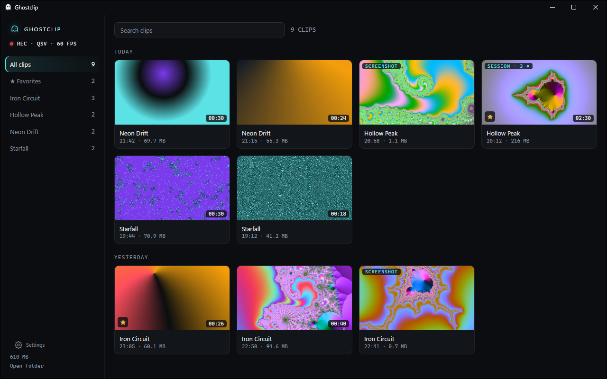

# Ghostclip

[](https://github.com/gabrielolvv/ghostclip/actions/workflows/ci.yml)
[](LICENSE)

[Português](README.pt-BR.md) · [Website](https://gabrielolvv.github.io/ghostclip/) · [Download for Windows](https://github.com/gabrielolvv/ghostclip/releases/latest/download/Ghostclip-win-Setup.exe)

Open-source instant replay recorder for Windows 10/11. It sits in the tray,
keeps the last minute of your screen, game audio and microphone, and saves a
clip when you press the hotkey. Goal number one is taking as few FPS from the
game as possible.



Nothing runs inside the game: no DLL injection, no render hooks, no memory
reads and no global keyboard hook. Capture uses Desktop Duplication or
Windows Graphics Capture, the hotkey uses `RegisterHotKey`, game-only audio uses Windows' own process
loopback, and encoding runs on the GPU's hardware encoder (NVENC, AMF or
QuickSync). There is no CPU encoder fallback.

## Features

- **Instant replay** of the last 60 s (configurable) on Alt+F10, saved as MP4
  in a folder per game, with no re-encode. An optional second key saves a clip
  of its own length, 15 s to start with.
- **Game-only audio.** Optionally records just the game: no Discord call, no
  music. It follows the game you're playing, not whatever window is in front.
- **Microphone on its own track,** so you can mute or rebalance it later.
  Alt+F8 mutes it while you play, without restarting recording.
- **Discord on its own track** (optional): the Discord app's sound is left out
  of the main track and recorded apart, so a call can be muted after the fact.
- **Screenshots** on Alt+F11, saved as JPEG next to the clips.
- **Session recording** on Alt+F9: keeps everything from start to stop, and
  the clip hotkey adds bookmarks you can jump to. It keeps the replay buffer
  instead of running a second encoder, so the game pays nothing extra.
- **Pause** from the tray or a key you choose: stops recording and deletes the
  replay buffer, for a bank's page or a password. It can also pause by itself
  while a program you list is in front.
- **Per-game profiles** for clip length, audio source and microphone mute.
- **Replay buffer on the drive you choose,** to spare the system's SSD.
- **Clip library.** Every clip and screenshot by game, with thumbnails, a
  player and a timeline over the audio waveform; a clip plays as you point at
  it; favorites, renaming and acting on several at once. It runs only while its window is open.
- **Trim** by dragging two handles, without re-encoding. The start snaps to
  a keyframe, so the result starts exactly where the timeline shows.
- **Compress for Discord:** re-encodes on the GPU to fit the upload limit
  (10 MB by default), mixing game and mic into one track.
- **Vertical copy** for Shorts, TikTok and Reels: the middle of the picture at
  1080x1920, encoded on the GPU. For this and the Discord copy, you choose which
  audio tracks go in, and at what volume.
- **GIF** of up to 15 s from the trim marks, for chats that won't play a video.
  It's the one export on the CPU, at low priority, only while it's being made.
- **Join clips** into one video, without re-encoding, for a compilation.
- **Space limit** (optional): past it, the oldest clips and screenshots make
  room for new ones. Favorites, clips you renamed and anything Ghostclip
  didn't make are never touched.
- **English, Portuguese or Spanish,** or whatever Windows uses, switched live.

## Install

Download `Ghostclip-win-Setup.exe` from the
[latest release](https://github.com/gabrielolvv/ghostclip/releases/latest) and
run it. It installs for your user only, with no admin prompt, starts in the
tray and updates itself from GitHub Releases: a new version downloads in the
background and installs when you exit Ghostclip or the next time it starts
(when you sign in, by default), or right away from "Update now" in the
library, never in the middle of a game. It
needs Windows 10 2004 or later and a GPU with NVENC, AMF or
QuickSync. Everything else, including .NET and FFmpeg, comes with it.

## Status

**0.8.** Recording on NVIDIA, AMD and Intel, saving, audio routing (with
Discord on its own track), profiles, screenshots, session recording with
bookmarks, the clip library with favorites, trimming and compression, the
space limit, the settings page in three languages, and the installer
with updates work.
Not done yet: game benchmark numbers,
code signing (see [docs/releasing.md](docs/releasing.md)) and a GIF for this
page (`assets\make-gif.ps1` makes one from a clip). The full plan is in
[docs/spec.md](docs/spec.md).

## How it works

```
Ghostclip.exe (tray)              Ghostclip.Worker.exe (headless)        ffmpeg.exe
  hotkey, settings, game       ⇄    supervises the recorder,        →     ddagrab → GPU encoder
  detection, saving, trimming,      game/system audio  ── pipe →          → 2 s MPEG-TS segments
  compression                       microphone         ── pipe →          %LOCALAPPDATA%\GhostclipData\Buffer
        named pipe (JSON)           rotates the buffer
```

- **Two processes.** The worker owns capture and audio and has no UI and no
  network. If it crashes or stops answering, the host restarts it. The buffer
  is on disk, so nothing is lost; a job object makes sure FFmpeg dies with it.
- **Frames stay on the GPU.** Captured at the clip rate (60 fps), not the
  monitor's, converted and encoded on the GPU. Only when a driver refuses the
  captured frames (seen with AMD's encoder on a Radeon RX 6600) does each
  frame take one copy through system memory; it is still encoded on the GPU.
- **Buffer.** 2 s segments with a keyframe at the start of each, numbered and
  rotated so only about one clip's worth stays on disk.
- **Saving.** The hotkey hard-links the segments into a pending folder (tens of
  milliseconds, whatever the disk) and the chime plays: the clip is safe from
  that moment. Then they are joined into an MP4 by stream copy, with no
  re-encode, at below-normal priority.
- **Audio.** Each track is WASAPI capture sent to FFmpeg over a named pipe,
  padded with silence against the QueryPerformanceCounter clock when nothing
  plays. Game-only audio switches the capture source (whole mix or one process
  tree) on the same pipe, so changing games never restarts recording. FFmpeg
  starts the audio clock about 150 ms before the first video frame; the worker
  measures that gap for each session and saving shifts the audio back.

## Build from source

Requires Windows 10 2004+ and the .NET 10 SDK.

```powershell
.\tools\get-tools.ps1        # LGPL FFmpeg and PresentMon into tools\
dotnet build
.\artifacts\bin\Debug\Ghostclip.exe
```

Tests: `dotnet test --project tests/Ghostclip.Core.Tests`. Building the
installer and the minimal FFmpeg is described in
[docs/releasing.md](docs/releasing.md).

## Usage

- **Alt+F10** saves to `Videos\Ghostclip\<Game>\<Game>_YYYY-MM-DD_HH-MM-SS.mp4`.
- Double-click the tray icon, or click a "Clip saved" notification, to open
  the library. The tray menu also shows what is being recorded and has
  settings and folders. The icon's dot is red while recording.
- In the library: copy a clip and paste it straight into Discord, compress
  it to Discord's size limit, show it in its folder or send it to the
  Recycle Bin. In the player, the arrows seek, comma and period go frame by
  frame, and I and O mark the trim.
- Settings are a page in the library (the gear in its sidebar, or Settings in
  the tray menu). They live in `%LOCALAPPDATA%\GhostclipData\config.json`;
  edit that by hand and the tray applies it right away. Saving from the page
  rewrites the file and drops any comments you added. Logs are in
  `%LOCALAPPDATA%\GhostclipData\Logs`.
- The app speaks English or Portuguese. By default it follows Windows;
  Settings > General > Language picks one, and the tray and library switch
  as soon as you save, without touching recording.
- Command line, for scripts, macros or a Stream Deck:

| Command | Does |
|---|---|
| `Ghostclip.exe --save` | The running instance saves a clip |
| `Ghostclip.exe --save-short` | Saves a short clip, of the length in Settings > Clips. Its buffer only holds more than the clip length while the short clip has a key |
| `Ghostclip.exe --screenshot` | Takes a screenshot |
| `Ghostclip.exe --session` | Starts or stops a session |
| `Ghostclip.exe --mute` | Mutes or unmutes the microphone track |
| `Ghostclip.exe --pause` | Pauses or resumes recording |
| `Ghostclip.exe --trim <clip> <start> <end>` | Writes `<clip>_trim.mp4` by stream copy |
| `Ghostclip.exe --compress <clip>` | Writes `<clip>_discord.mp4` under the Discord limit |

## If a game loses FPS

Recording always costs the game something: the GPU copies each frame and its
encoder compresses it. If the drop is more than you'd like, try these in
order, one at a time, so you know which one helped:

1. **Keep Games first on** (Settings > Advanced, on by default). The recorder
   runs below normal priority on the CPU and the GPU, so it waits behind the
   game's frames.
2. **Switch the capture** to Windows Graphics Capture (Settings > Video >
   Capture). On some GPUs and games it costs less than Desktop Duplication.
3. **Record at 30 FPS** instead of 60 (Settings > Video > Frame rate): half
   the frames to copy and encode.
4. **Record at a lower resolution,** 1080p or 720p on a 1440p or 4K monitor
   (Settings > Video > Resolution). The GPU scales the picture before it is
   encoded.

To report it, press **Copy diagnostics** (Settings > Advanced) and paste the
result in an [FPS report](https://github.com/gabrielolvv/ghostclip/issues/new?template=fps_report.yml) with
the game, its FPS with Ghostclip off and on, and which of the steps above you
tried. It holds your GPUs and drivers, the Windows version, the capture and
priority settings and the log lines saying which encoder and priority ran;
no file names or personal data.

## Measurements

i7-13620H laptop, Intel UHD only (QuickSync), 1080p60, H.264 20 Mbps, idle
desktop. **Not a game benchmark yet**, so there are no FPS numbers.

| Measure | Result | Target |
|---|---:|---:|
| Clip safe after the hotkey | 15–130 ms | |
| MP4 written | ~1.1–1.4 s | < 2 s |
| CPU: ffmpeg + worker (one 10 s sample) | ~1.3% | < 1% |
| RAM: ffmpeg + worker (working set) | ~146–161 MB + ~45 MB | < 150 MB |
| Audio vs. video after compensation | 53–98 ms, including the test's own playback latency | |
| Worker crash → recording again | ~1.3 s, buffer kept | |
| Game-only audio: another app's sound on the game track | 35 dB below the game | |
| Trim 10 s out of a 22 s clip | stream copy, under a second | |
| Compress 24 s for a 10 MB limit | 8.7 MB, 720p60, 7–9 s | ≤ 10 MB |

RAM is over target on this machine. On an integrated GPU, video surfaces live
in system RAM and count towards FFmpeg's memory; on a dedicated GPU they would
be in VRAM. A native capture and encode spike (DXGI + Media Foundation, in
[spike/native](spike/native/README.md)) used more memory, not less, because
both paths sit on the same Intel media driver. So Ghostclip stays on FFmpeg.

### Measure it on your PC

The benchmark runs a game's built-in benchmark with Ghostclip off and on,
alternating, and writes the table above with FPS and 1% lows from
[PresentMon](https://github.com/GameTechDev/PresentMon). It measures the real
app with your settings: host, worker and FFmpeg together, plus a clip saved
halfway through each round. From PowerShell as administrator:

```powershell
.\tools\get-tools.ps1                                            # PresentMon
.\bench\run-bench.ps1 -ProcessName "Game.exe" -SaveDuringRun     # 3 rounds off, 3 on
```

Results land in `bench\results\<date>\summary.md`. Numbers from other GPUs,
NVIDIA and AMD especially, are very welcome in an issue.

## Known limitations

- The measurements above are QuickSync only. AMF has run on a Radeon RX 6600,
  where two driver problems were found and worked around (see the
  [changelog](CHANGELOG.md)). NVENC records on NVIDIA cards too, but
  there are no published numbers for it yet: an
  [FPS report](https://github.com/gabrielolvv/ghostclip/issues/new?template=fps_report.yml)
  from an NVIDIA or AMD card helps.
- Trimming by stream copy starts at a keyframe, every 2 s; the library snaps
  the start there, and `--trim` cuts from the keyframe before the start.
- The library's player needs the HEVC Video Extensions from the Microsoft
  Store to show HEVC clips; without them it plays the sound only. H.264,
  the default, always plays. The preview plays the game track; the
  microphone is in the file and in the Discord version.
- Game detection for game-only audio: a program counts as the game when it
  runs fullscreen or borderless, or has a profile. A windowed game needs a
  profile.
- If a clip crosses a worker crash, it skips the second or so the restart took.
- Changing a video setting or turning the microphone on or off restarts
  recording and clears the buffer, because segments in two formats can't be
  joined without re-encoding. The audio source and per-game settings switch
  live.

## License

[MIT](LICENSE). Changes are listed in [CHANGELOG.md](CHANGELOG.md). FFmpeg is
not part of this repository. Releases ship a minimal LGPL build made by [build/ffmpeg](build/ffmpeg) (no GPL or nonfree components)
that Ghostclip runs as a separate program; for development
`tools\get-tools.ps1` downloads an LGPL build.
