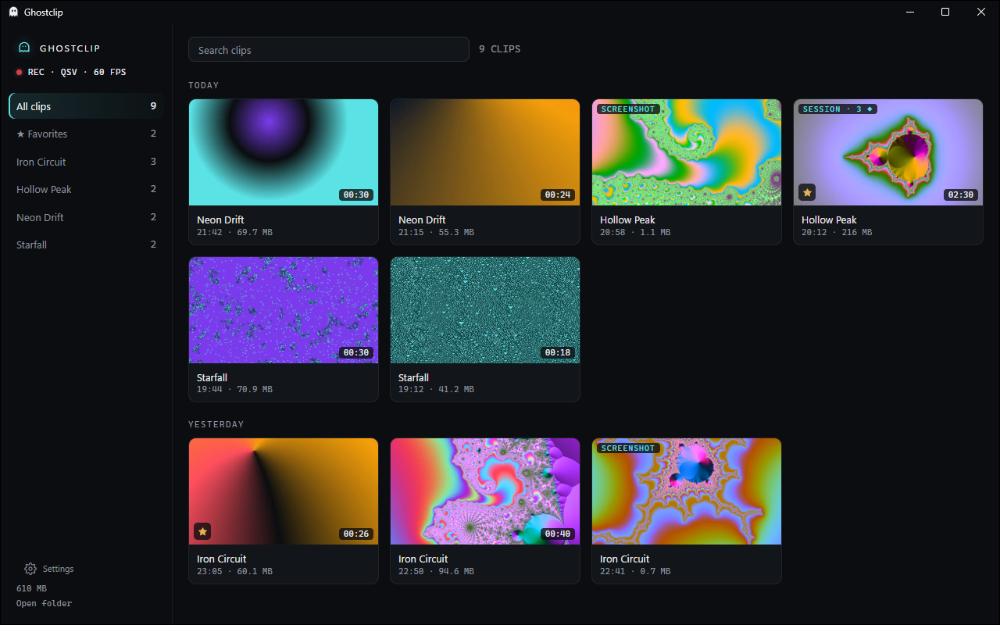

# Ghostclip

[](https://github.com/gabrielolvv/ghostclip/actions/workflows/ci.yml)
[](LICENSE)

[English](README.md) · [Site](https://gabrielolvv.github.io/ghostclip/?lang=pt) · [Baixar para Windows](https://github.com/gabrielolvv/ghostclip/releases/latest/download/Ghostclip-win-Setup.exe)

Gravador de "instant replay" open-source para Windows 10/11. Fica na bandeja,
guarda o último minuto da tela, do áudio do jogo e do microfone, e salva um
clipe quando você aperta a hotkey. O objetivo nº 1 é tirar o mínimo possível
de FPS do jogo.



Nada roda dentro do jogo: sem injeção de DLL, sem hook de renderização, sem
leitura de memória e sem hook global de teclado. A captura usa o Desktop
Duplication ou o Windows Graphics Capture, a hotkey usa `RegisterHotKey`, o áudio só do jogo usa o process
loopback do próprio Windows e a codificação roda no encoder de hardware da GPU
(NVENC, AMF ou QuickSync). Não existe fallback para encoder de CPU.

## Recursos

- **Instant replay** dos últimos 60 s (configurável) no Alt+F10, salvo em MP4
  numa pasta por jogo, sem reencode. Uma segunda tecla opcional salva um clipe
  com duração própria, 15 s de início.
- **Áudio só do jogo.** Opcionalmente grava só o jogo: sem a chamada do
  Discord, sem música. Ele segue o jogo que você está jogando, não qualquer
  janela em primeiro plano.
- **Microfone em faixa separada,** para silenciar ou rebalancear depois.
  O Alt+F8 muta o microfone durante o jogo, sem reiniciar a gravação.
- **Discord em faixa própria** (opcional): o som do app do Discord sai da
  faixa principal e é gravado à parte, para dar para silenciar a call depois.
- **Prints** no Alt+F11, salvos em JPEG junto dos clipes.
- **Gravação da sessão** no Alt+F9: guarda tudo do começo ao fim, e a hotkey
  de clipe adiciona marcadores para pular até o momento. Ela aproveita o
  buffer de replay em vez de rodar um segundo encoder, então o jogo não paga
  nada a mais.
- **Pausa** pela bandeja ou por uma tecla que você escolhe: para a gravação e
  apaga o buffer de replay, para a página do banco ou uma senha. Também pausa
  sozinha enquanto um programa da sua lista estiver na frente.
- **Perfis por jogo** para duração do clipe, fonte de áudio e microfone mudo.
- **Buffer de replay no disco que você escolher,** para poupar o SSD do sistema.
- **Biblioteca de clipes.** Todos os clipes e prints por jogo, com miniaturas,
  player e linha do tempo sobre a forma de onda do áudio; o clipe toca quando você
  aponta para ele; favoritos, renomear e ações em vários de uma vez. Só roda enquanto a janela está aberta.
- **Corte** arrastando duas alças, sem reencode. O início encaixa num
  keyframe, então o resultado começa exatamente onde a linha do tempo mostra.
- **Comprimir para o Discord:** reencoda na GPU para caber no limite de upload
  (10 MB por padrão), juntando jogo e microfone numa faixa só.
- **Enviar ao Discord** pelo player, por um webhook seu, ajustado ao limite. É o
  único jeito de um clipe sair do seu PC, e só quando você clica.
- **Cópia vertical** para Shorts, TikTok e Reels: o meio da imagem em 1080x1920,
  codificado na GPU. Nesta e na cópia para o Discord, você escolhe quais faixas
  de áudio entram e em que volume.
- **GIF** de até 15 s a partir do trecho marcado, para conversas que não tocam vídeo.
  É a única exportação na CPU, em baixa prioridade, só enquanto está sendo feito.
- **Salvar um quadro** do clipe como imagem, exatamente o que está na tela.
- **Juntar clipes** num vídeo só, sem reencode, para um compilado.
- **Limite de espaço** (opcional): passado dele, os clipes e prints mais
  antigos dão lugar aos novos. Favoritos, clipes renomeados e qualquer coisa
  que o Ghostclip não criou nunca são tocados.
- **Inglês, português ou espanhol,** ou o idioma do Windows, trocado na hora.

## Instalar

Baixe o `Ghostclip-win-Setup.exe` do
[último release](https://github.com/gabrielolvv/ghostclip/releases/latest) e
execute. Ele instala só para o seu usuário, sem pedir admin, abre na bandeja e
se atualiza pelo GitHub Releases: a versão nova é baixada em segundo plano e
instalada quando você sai do Ghostclip ou na próxima vez que ele abre (ao
entrar no Windows, por padrão), ou na hora pelo botão
"Atualizar agora" da biblioteca, nunca no meio de um jogo. Requer Windows 10
2004 ou mais novo e uma GPU com NVENC, AMF ou QuickSync. Todo o resto, inclusive
o .NET e o FFmpeg, vem junto.

## Estado

**0.8.** Funcionam gravação em NVIDIA, AMD e Intel, save, roteamento de áudio
(com o Discord em faixa própria), perfis, prints, gravação da sessão com
marcadores, a biblioteca de clipes com favoritos, corte e compressão, o limite
de espaço, a página de configurações em três idiomas e o instalador com
atualizações. Ainda
falta: números de benchmark
em jogo, assinatura de código (veja [docs/releasing.md](docs/releasing.md), em
inglês) e um GIF para esta página (`assets\make-gif.ps1` gera um a partir de
um clipe). O plano completo está em [docs/spec.md](docs/spec.md) (em inglês).

## Como funciona

```
Ghostclip.exe (bandeja)           Ghostclip.Worker.exe (sem UI)          ffmpeg.exe
  hotkey, config, detecção     ⇄    supervisiona o gravador,        →     ddagrab → encoder da GPU
  do jogo, save, corte,             áudio do jogo/sistema ── pipe →       → segmentos MPEG-TS de 2 s
  compressão                        microfone             ── pipe →       %LOCALAPPDATA%\GhostclipData\Buffer
        named pipe (JSON)           rotação do buffer
```

- **Dois processos.** O worker cuida da captura e do áudio, sem UI e sem rede.
  Se ele travar ou parar de responder, o host o reinicia. O buffer está em
  disco, então nada se perde; um job object garante que o FFmpeg morra junto.
- **Os frames ficam na GPU.** Capturados na taxa do clipe (60 fps), não na do
  monitor, e convertidos e codificados na GPU. Só quando um driver recusa os
  frames capturados (visto com o encoder da AMD numa Radeon RX 6600) cada
  frame passa uma vez pela memória do sistema; a codificação continua na GPU.
- **Buffer.** Segmentos de 2 s, cada um começando num keyframe, numerados e
  rotacionados para manter em disco só o equivalente a um clipe.
- **Salvar.** A hotkey cria hard links dos segmentos numa pasta pendente
  (dezenas de milissegundos, seja qual for o disco) e o som toca: a partir daí
  o clipe está garantido. Depois eles viram um MP4 por stream copy, sem
  reencode, com prioridade abaixo do normal.
- **Áudio.** Cada faixa é uma captura WASAPI enviada ao FFmpeg por named pipe e
  completada com silêncio pelo relógio do QueryPerformanceCounter quando nada
  toca. O modo "só o jogo" troca a fonte (a mixagem inteira ou a árvore de um
  processo) no mesmo pipe, então trocar de jogo nunca reinicia a gravação. O
  FFmpeg começa o relógio do áudio uns 150 ms antes do primeiro frame de vídeo;
  o worker mede essa diferença a cada sessão e o save desloca o áudio de volta.

## Compilar do código-fonte

Requer Windows 10 2004+ e o SDK do .NET 10.

```powershell
.\tools\get-tools.ps1        # FFmpeg LGPL e PresentMon em tools\
dotnet build
.\artifacts\bin\Debug\Ghostclip.exe
```

Testes: `dotnet test --project tests/Ghostclip.Core.Tests`. Como gerar o
instalador e o FFmpeg mínimo está em [docs/releasing.md](docs/releasing.md).

## Uso

- **Alt+F10** salva em `Vídeos\Ghostclip\<Jogo>\<Jogo>_AAAA-MM-DD_HH-MM-SS.mp4`.
- Clique duas vezes no ícone da bandeja, ou numa notificação "Clipe salvo",
  para abrir a biblioteca. O menu da bandeja também mostra o que está sendo
  gravado e tem configurações e pastas. O ponto do ícone fica vermelho
  enquanto grava.
- Na biblioteca: copie um clipe e cole direto no Discord, comprima para o
  limite do Discord, mostre na pasta ou mande para a Lixeira. No player, as
  setas navegam, vírgula e ponto andam quadro a quadro, I e O marcam o corte, e < e > mudam a
  velocidade, de 0,25x a 2x.
- As configurações são uma página da biblioteca (a engrenagem na barra
  lateral, ou Configurações no menu da bandeja). Elas ficam em
  `%LOCALAPPDATA%\GhostclipData\config.json`; editado à mão, a bandeja aplica
  na hora. Salvar pela página reescreve o arquivo e apaga os comentários que
  você tiver escrito nele. Os logs ficam em `%LOCALAPPDATA%\GhostclipData\Logs`.
- O app fala português ou inglês. Por padrão segue o idioma do Windows;
  Configurações > Geral > Idioma escolhe um, e a bandeja e a biblioteca
  trocam assim que você salva, sem mexer na gravação.
- Linha de comando, para scripts, macros ou Stream Deck:

| Comando | Faz |
|---|---|
| `Ghostclip.exe --save` | A instância em execução salva um clipe |
| `Ghostclip.exe --save-short` | Salva um clipe curto, da duração em Configurações > Clipes. O buffer só guarda mais que a duração do clipe enquanto o clipe curto tem tecla |
| `Ghostclip.exe --screenshot` | Tira um print |
| `Ghostclip.exe --session` | Começa ou para uma sessão |
| `Ghostclip.exe --mute` | Muta ou desmuta a faixa do microfone |
| `Ghostclip.exe --pause` | Pausa ou retoma a gravação |
| `Ghostclip.exe --trim <clipe> <início> <fim>` | Gera `<clipe>_trim.mp4` por stream copy |
| `Ghostclip.exe --compress <clipe>` | Gera `<clipe>_discord.mp4` dentro do limite do Discord |

## Se o jogo perder FPS

Gravar sempre custa alguma coisa ao jogo: a GPU copia cada quadro e o encoder
dela o comprime. Se a queda for maior do que você quer, tente estes passos em
ordem, um de cada vez, para saber qual ajudou:

1. **Deixe a Prioridade para os jogos ligada** (Configurações > Avançado,
   ligada por padrão). O gravador roda abaixo da prioridade normal na CPU e
   na GPU, então espera atrás dos quadros do jogo.
2. **Troque a captura** para Windows Graphics Capture (Configurações > Vídeo >
   Captura). Em algumas GPUs e jogos ela custa menos que o Desktop
   Duplication.
3. **Grave a 30 FPS** em vez de 60 (Configurações > Vídeo > Taxa de quadros):
   metade dos quadros para copiar e codificar.
4. **Grave numa resolução menor,** 1080p ou 720p num monitor 1440p ou 4K
   (Configurações > Vídeo > Resolução). A GPU reduz a imagem antes de
   codificar.

Para relatar, aperte **Copiar diagnóstico** (Configurações > Avançado) e cole
o resultado num [relato de FPS](https://github.com/gabrielolvv/ghostclip/issues/new?template=fps_report.yml) com
o jogo, o FPS com o Ghostclip desligado e ligado, e quais dos passos acima
você tentou. Ele traz suas GPUs e drivers, a versão do Windows, as opções de
captura e prioridade e as linhas do log que dizem qual encoder e qual
prioridade rodaram; nenhum nome de arquivo nem dado pessoal.

## Medições

Notebook i7-13620H, só Intel UHD (QuickSync), 1080p60, H.264 20 Mbps, área de
trabalho parada. **Ainda não é benchmark em jogo**, então não há números de FPS.

| Medida | Resultado | Meta |
|---|---:|---:|
| Clipe garantido após a hotkey | 15–130 ms | |
| MP4 gravado | ~1,1–1,4 s | < 2 s |
| CPU: ffmpeg + worker (uma amostra de 10 s) | ~1,3% | < 1% |
| RAM: ffmpeg + worker (working set) | ~146–161 MB + ~45 MB | < 150 MB |
| Áudio vs. vídeo depois da compensação | 53–98 ms, incluindo a latência de reprodução do próprio teste | |
| Crash do worker → gravando de novo | ~1,3 s, buffer mantido | |
| Áudio só do jogo: som de outro app na faixa do jogo | 35 dB abaixo do jogo | |
| Cortar 10 s de um clipe de 22 s | stream copy, menos de um segundo | |
| Comprimir 24 s para limite de 10 MB | 8,7 MB, 720p60, 7–9 s | ≤ 10 MB |

A RAM passa da meta nesta máquina. Numa GPU integrada, as superfícies de vídeo
ficam na RAM do sistema e contam na memória do FFmpeg; numa GPU dedicada
ficariam na VRAM. Um spike de captura e codificação nativas (DXGI + Media
Foundation, em [spike/native](spike/native/README.md), em inglês) gastou mais
memória, não menos, porque os dois caminhos usam o mesmo driver de mídia da
Intel. Por isso o Ghostclip continua no FFmpeg.

### Meça no seu PC

O benchmark roda o benchmark embutido de um jogo com o Ghostclip desligado e
ligado, alternando, e gera a tabela acima com FPS e 1% low pelo
[PresentMon](https://github.com/GameTechDev/PresentMon). Ele mede o app de
verdade com as suas configurações: host, worker e FFmpeg juntos, mais um clipe
salvo no meio de cada rodada. No PowerShell como administrador:

```powershell
.\tools\get-tools.ps1                                            # PresentMon
.\bench\run-bench.ps1 -ProcessName "Jogo.exe" -SaveDuringRun     # 3 rodadas desligado, 3 ligado
```

Os resultados ficam em `bench\results\<data>\summary.md`. Números de outras
GPUs, principalmente NVIDIA e AMD, são muito bem-vindos numa issue.

## Limitações conhecidas

- As medições acima são só do QuickSync. O AMF já rodou numa Radeon RX 6600,
  onde dois problemas do driver foram encontrados e contornados (veja o
  [changelog](CHANGELOG.md)). O NVENC também grava em placas NVIDIA, mas
  ainda não há números publicados dele: um
  [relato de FPS](https://github.com/gabrielolvv/ghostclip/issues/new?template=fps_report.yml)
  de uma placa NVIDIA ou AMD ajuda.
- O corte por stream copy começa num keyframe, a cada 2 s; a biblioteca
  encaixa o início ali, e o `--trim` corta a partir do keyframe anterior.
- O player da biblioteca precisa das Extensões de Vídeo HEVC da Microsoft
  Store para mostrar clipes HEVC; sem elas, toca só o som. H.264, o padrão,
  sempre toca. A prévia toca a faixa do jogo; o microfone está no arquivo e
  na versão para o Discord.
- Detecção do jogo para o áudio só do jogo: um programa conta como jogo quando
  roda em tela cheia ou sem borda, ou quando tem perfil. Jogo em janela precisa
  de perfil.
- Um clipe que atravessa um crash do worker perde o segundo e pouco que o
  reinício levou.
- Mudar uma configuração de vídeo ou ligar/desligar o microfone reinicia a
  gravação e limpa o buffer, porque segmentos em dois formatos não se juntam
  sem reencode. A fonte de áudio e as configurações por jogo trocam ao vivo.

## Licença

[MIT](LICENSE). As mudanças estão em [CHANGELOG.md](CHANGELOG.md) (em inglês).
O FFmpeg não faz parte deste repositório. Os releases levam uma
build LGPL mínima feita por [build/ffmpeg](build/ffmpeg) (sem componentes GPL
nem nonfree), que o Ghostclip executa como programa separado; para
desenvolvimento, o `tools\get-tools.ps1` baixa uma build LGPL.
